[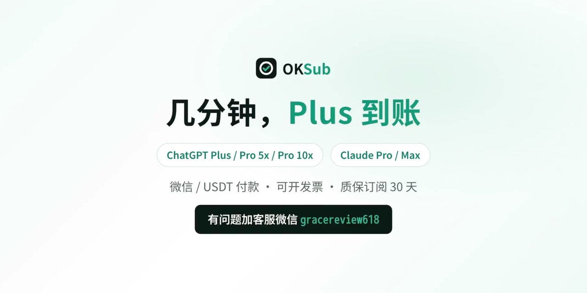](https://oksub.net/)

**🌐 Language / 语言:** [简体中文](./README.md) | **English** | [Русский](./README.ru.md)

# 🚀 ChatGPT Plus / Pro Top-Up & Subscription Guide (2026) — Pay for ChatGPT Without an International Card, Activated in Minutes (Claude Top-Up Too)

**How to pay for / subscribe to ChatGPT Plus in 2026 — step-by-step video & picture guide for beginners**

> A **ChatGPT Plus top-up guide** for users without an international credit card: on the all-in-one top-up site **[OKSub (oksub.net)](https://oksub.net/)** you **pay with WeChat Pay or USDT**, then **top up your own ChatGPT account yourself** on the order page — no account password required. This article walks through the full **picture + video** flow: choosing a plan, paying, copying your account info, and confirming Plus status.
>
> 📅 Last updated: November 2026

## 📌 One-Sentence Answer: How do I pay for ChatGPT Plus without an international card?

No international credit card needed. Open **[oksub.net](https://oksub.net/)**, choose the ChatGPT Plus plan, enter your email and **pay with WeChat Pay or USDT**. After payment you are taken to your order page automatically. In the browser where you are logged in to ChatGPT, open `chatgpt.com/api/auth/session`, select and copy everything on that page, paste it back into the order page and **submit the top-up directly**. Usually within a few minutes, refresh ChatGPT and your account goes from **Free to Plus**. The whole process upgrades your own account (not a shared or pooled account), your chat history is fully kept, and the subscription carries a 30-day warranty.

## 🎬 Video Tutorial (~2-minute full walkthrough with voice-over, in Chinese)

Watch the full flow once (about 2 minutes) to get the big picture, then follow the picture steps below.

[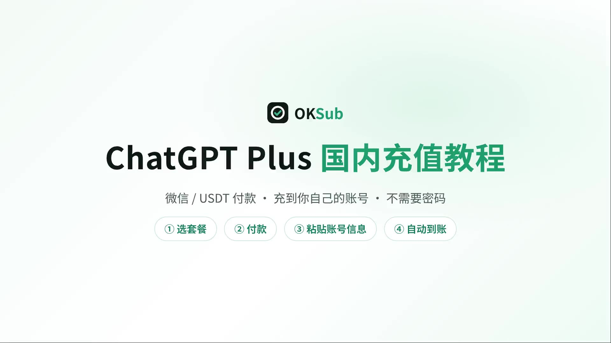](./plus-tutorial-v2.mp4)

> ▶️ Click the cover above to play the video. You can also watch it on the [OKSub home page](https://oksub.net/) or [download the video file](./plus-tutorial-v2.mp4). The email and account shown in the video are demo data.

## 📋 Key Facts at a Glance

| Item | Details |
| --- | --- |
| Who it's for | Users who already have their own ChatGPT account but no international credit card |
| Price | ChatGPT Plus **¥135 / month** (30 days, equivalent to the official $20/month); Pro 100 ¥699 and Pro 200 ¥1200 also available |
| Payment | **WeChat Pay** (recommended, scan to pay), **USDT-BEP20**, **USDT-Polygon** |
| How it works | After payment, paste your session account info on the order page and submit the top-up directly — usually done in a few minutes |
| Account requirement | Plus requires the account to currently be **Free** (no active subscription); Pro 100 can be applied on top of an existing plan |
| Password needed? | No — you only paste the session page content on the order page; **it's your own account being upgraded, so your chat history is fully kept** |
| Warranty | 30-day subscription warranty; if Plus drops mid-way, contact support |
| Invoice | Electronic invoice available (choose "Need invoice" when ordering, +¥10 per order) |
| Codex? | Yes |
| Other services | [Ready-made Claude Pro / Max accounts (no KYC)](https://github.com/sunreview/Claude-Pro-Subscription-Guide) |
| Support | WeChat `gracereview716` / Telegram `@aispace_kefu` |

---

## 1. 🧰 What do you need to top up ChatGPT Plus?

The whole top-up process can be summed up as:

**Choose plan → Enter email → Pay with WeChat / USDT → Copy session account info → Paste and submit directly → Refresh ChatGPT to see Plus**

Before you start, it's best to have the following ready.

### ① A ChatGPT account you can log in to

Open ChatGPT in your browser first and confirm:

- You can log in normally;

- The email is the account you want to upgrade;

- The current plan is **Free** (Plus can only be applied to an account with no active subscription);

- It's a personal account: if you joined a Team workspace, switch back to your personal account first.

### ② An email address you use regularly

You enter an email when ordering. After payment, the order page link is sent to this email so you can come back any time to continue the top-up or check the order.

### ③ WeChat Pay or USDT

WeChat scan-to-pay is recommended; USDT-BEP20 (BSC chain) and USDT-Polygon (low fees) are also supported.

---

## 2. 🖼️ ChatGPT Plus Top-Up Picture Steps

Now for the actual top-up. After watching the video above, follow the picture steps below one by one.

### Step 1: Open OKSub and choose ChatGPT Plus 🚪

Open **[oksub.net](https://oksub.net/)**, scroll down to "ChatGPT 套餐" (ChatGPT plans) and click **"立即充值"** (Top up now) on the **ChatGPT Plus** card (¥135 / month · 30 days).

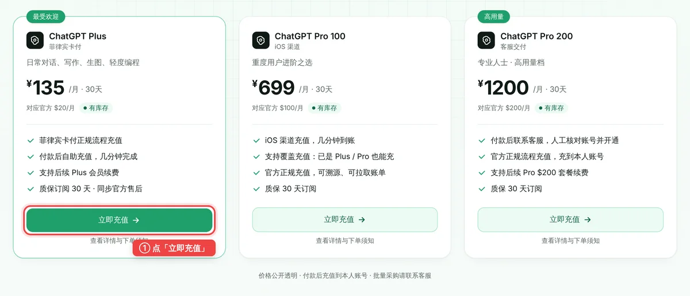

You can also open the checkout page directly: [oksub.net/checkout/chatgpt-plus](https://oksub.net/checkout/chatgpt-plus)

### Step 2: Enter your email and choose a payment method ✉️

You land on **"第一步：填写信息"** (Step 1: Fill in your details):

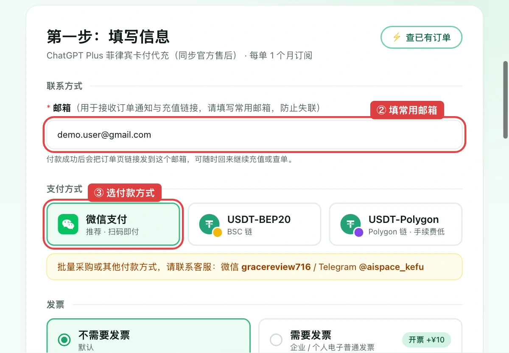

- **Email**: use an email you check regularly. After payment, the link to your order page is sent here, so you can come back any time to continue the top-up or look up the order.
- **Payment method**: pick one of WeChat Pay (recommended, scan to pay), USDT-BEP20 (BSC chain) or USDT-Polygon (low fees).

> 💡 For bulk purchases or other payment methods, contact support: WeChat **gracereview716** / Telegram **@aispace_kefu**.

### Step 3: Read the notes and click "立即支付" (Pay now) 💳

Scroll down. **Invoice** defaults to "不需要发票" (No invoice); choose "需要发票" (Invoice needed) if you want one. Then read the yellow **"下单前请确认"** (Please confirm before ordering) box carefully:

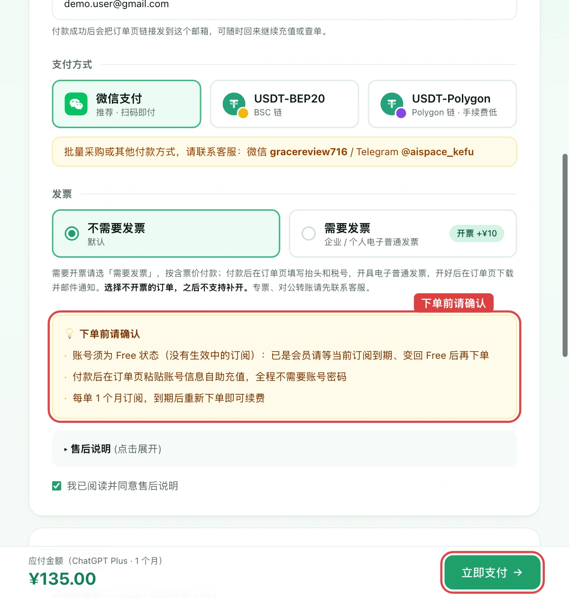

- The account must be on **Free** (no active subscription);
- After payment you paste your account info on the order page and top up yourself — **no account password is needed at any point**;
- Each order is a **1-month** subscription; place a new order to renew when it expires.

If everything is fine and "我已阅读并同意售后说明" (I have read and agree to the after-sales terms) is ticked (it is by default), click **"立即支付"** (Pay now) at the bottom right.

### Step 4: Confirm the order and scan to pay 📱

On the **"确认付款"** (Confirm payment) page, check the plan, amount and contact email, then click **"前往安全支付"** (Go to secure payment):

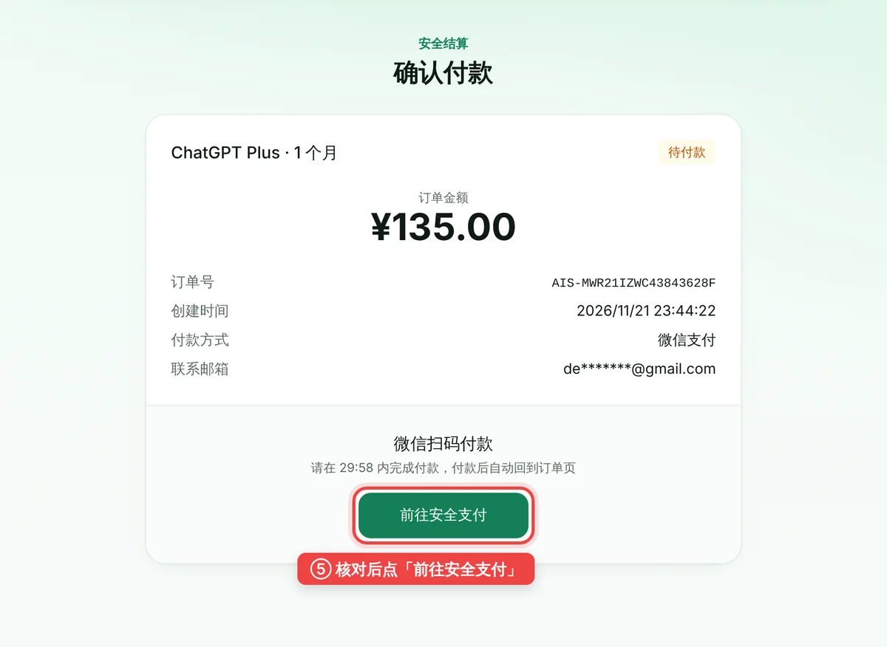

A WeChat payment QR code appears — just **scan it with WeChat to pay**. If you are ordering on your phone, take a screenshot of the QR code and, in WeChat's "Scan", tap the album icon at the top right to read it:

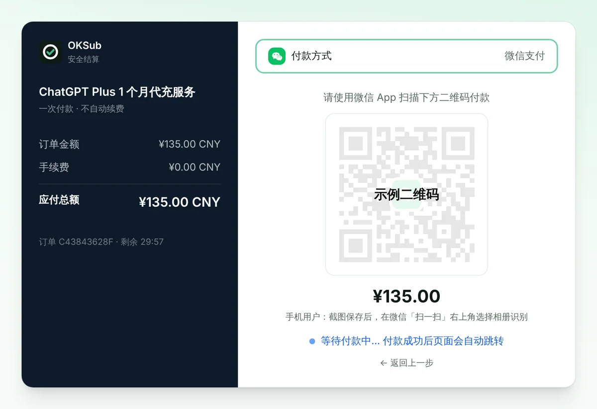

- ⏰ Please pay **within 30 minutes**; expired orders become invalid and you'll need to order again.
- 🙅 You **don't need to send a screenshot** to anyone after paying — the page detects the payment automatically.
- If you chose USDT, the page shows the receiving address and **the exact amount to the decimal place**. Use the matching network and send exactly the amount shown.

### Step 5: Payment successful — go to the order page 🎉

Once the payment arrives, the page shows **"付款成功！"** (Payment successful!) and jumps to the order page after 3 seconds; you can also click **"前往充值"** (Go to top-up):

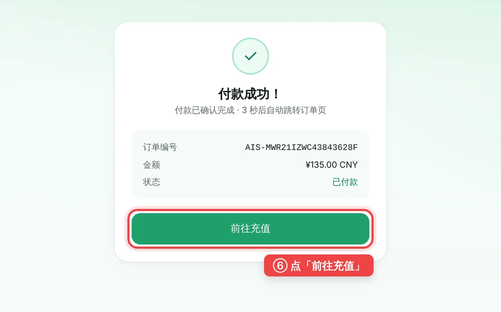

The order page shows the status **"已付款"** (Paid) and the next step "开始充值" (Start top-up). We recommend clicking **"复制"** (Copy) next to the order number and saving it first — you'll need it to look up the order or contact support 📝

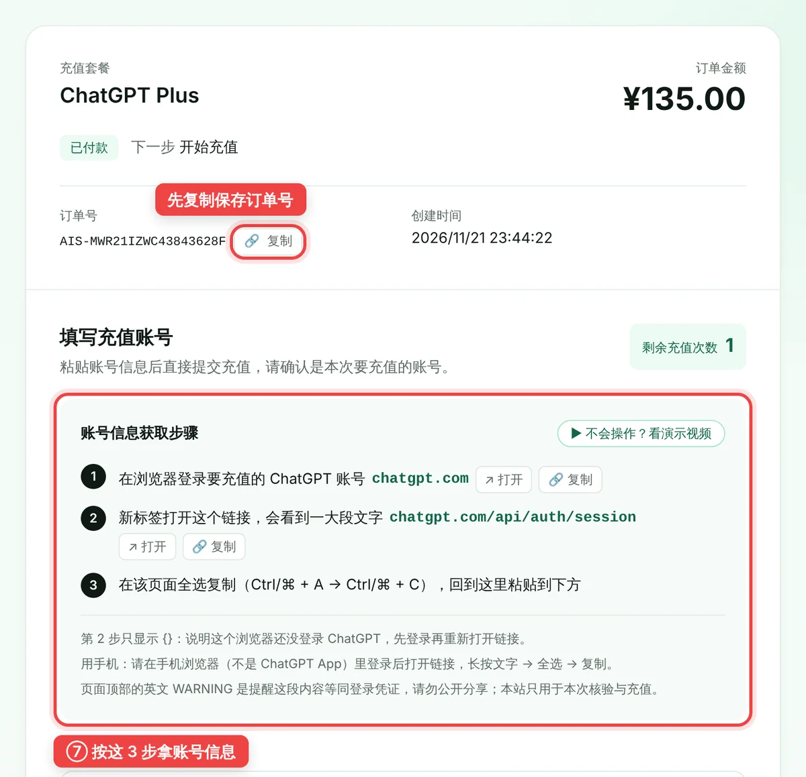

> 📬 Closed the page by accident? No problem: the order page link has been sent to your order email, and you can also find it on [Order lookup](https://oksub.net/orders) by entering the order number or email.

### Step 6: Copy your account info, paste it and submit the top-up 🔗

This is the most important step. Follow the **"账号信息获取步骤"** (How to get your account info) on the order page:

**① Log in to the ChatGPT account you want to top up in your browser**

Open [chatgpt.com](https://chatgpt.com) and make sure you are logged in to the account you want to upgrade to Plus. If several accounts are logged in on that browser, check which one is active first.

**② In the same browser, open a new tab and go to this link**

👉 **chatgpt.com/api/auth/session**

The order page has "打开" (Open) and "复制" (Copy) buttons for it. You'll see **a long block of English text and symbols** — that is your account info:

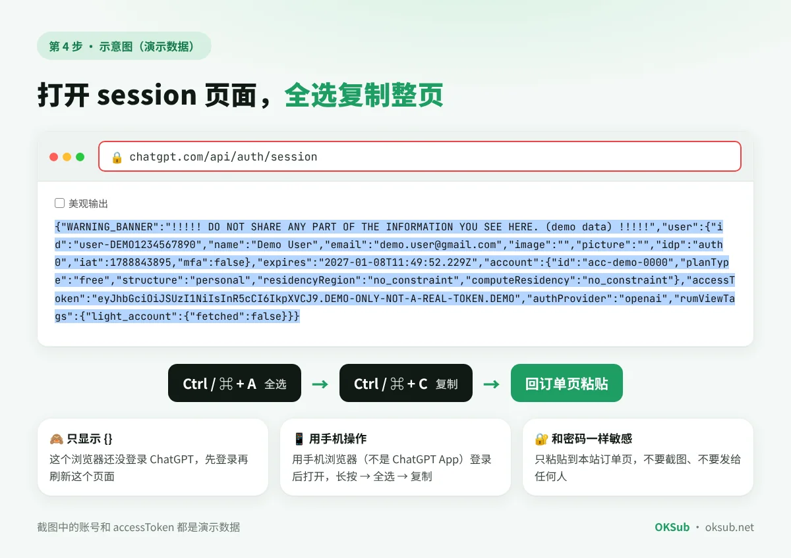

**③ Select and copy the whole page, then paste it on the order page**

- **Windows**: press `Ctrl + A` to select all, then `Ctrl + C` to copy;
- **Mac**: press `⌘ + A` to select all, then `⌘ + C` to copy;
- **Phone**: log in using your phone's browser (**not the ChatGPT app**), open the link, long-press the text → Select all → Copy.

Back on the order page, paste it into the **"粘贴完整账号信息 JSON"** (Paste full account info JSON) box (`Ctrl/⌘ + V`), then click **"提交充值"** (Submit top-up):

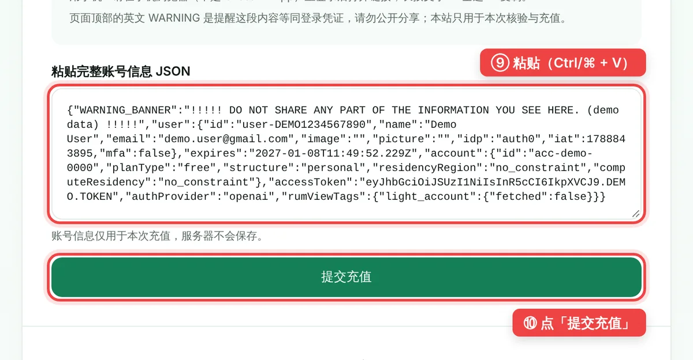

Keep these in mind 👇

- ✂️ **Copy the whole page**, not just part of it. For ChatGPT Plus, the content is **submitted directly** after pasting — there is no pre-check step — so an incomplete copy will make the top-up fail.
- 🙈 **The page only shows `{}`**: this browser isn't logged in to ChatGPT yet. Log in first, then refresh the session page.
- 🌐 **Turn off browser translation extensions first** — translated content gets scrambled.
- 🔐 **This content is as sensitive as a password** (it contains your login credential, the accessToken) — that's what the English WARNING at the top of the page is about. **Paste it only into the order page on this site.** Don't screenshot it or send it to anyone, including people claiming to be support. We use it only for this top-up, and the server does not store it.

### ✅ Wait for the top-up to finish, then check ChatGPT 💎

After you submit, the system handles it automatically. Progress goes **提交充值 (Submitted) → 充值处理 (Processing) → 充值完成 (Complete)**, usually within a few minutes. While waiting, **don't log out of ChatGPT, don't switch accounts and don't submit again**. You can close the page — you'll get an email when it's done.

When you see **"100% · 充值服务已确认完成"** (100% · Top-up confirmed complete), the top-up has succeeded 🎉

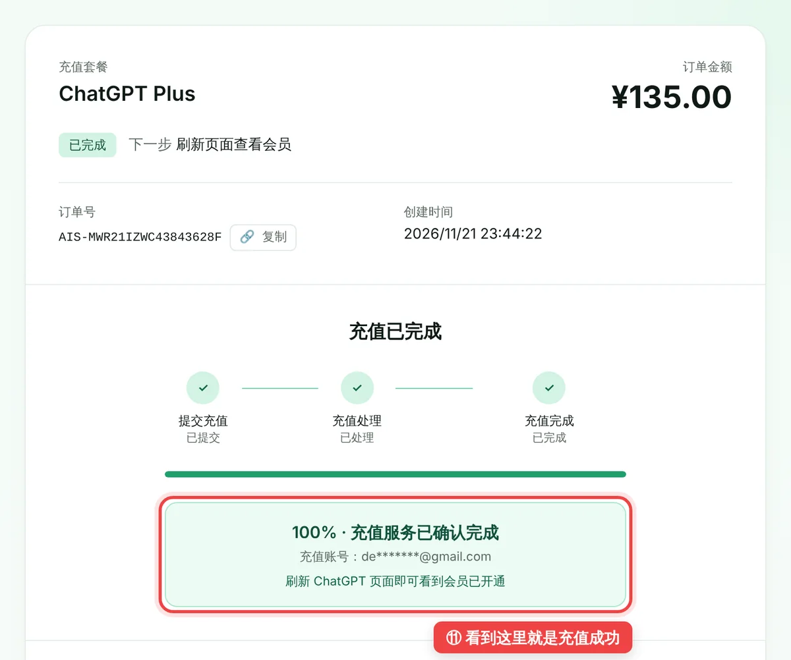

Finally, go back to ChatGPT and **refresh the page**: if the label under your name at the bottom left changes from "Free" to **"Plus"**, or you see **ChatGPT Plus** under Settings → **Billing**, the upgrade worked 💎

If it still shows Free after refreshing, try in order: wait a few dozen seconds → refresh again → log out of ChatGPT and log back in → check Billing. If it still doesn't work, contact support with your order number.

---

## 3. ❓ ChatGPT Plus Top-Up FAQ

### Q1: How do I pay for ChatGPT without an international card? Which payment methods are supported?

**WeChat Pay** and **USDT (BEP20 / Polygon)** are supported — no overseas credit card, PayPal or virtual card needed. After payment you go straight to the order page, paste your account info and top up yourself, usually within a few minutes.

### Q2: How do I activate ChatGPT Plus?

No international credit card needed: choose the ChatGPT Plus plan on [oksub.net](https://oksub.net/), pay with WeChat Pay or USDT, then paste your session account info on the order page and submit the top-up directly — Plus is usually active within a few minutes. See "ChatGPT Plus Top-Up Picture Steps" above for details.

### Q3: How much is ChatGPT Plus per month? Plus or Pro?

| Plan | Price (30 days) | Official equivalent | Best for |
| --- | --- | --- | --- |
| ChatGPT Plus | ¥135 | $20/month | Everyday chat, writing, image generation, light coding |
| ChatGPT Pro 100 | ¥699 | $100/month | Heavy users who need more Codex and other usage |
| ChatGPT Pro 200 | ¥1200 | $200/month | Professionals, highest usage tier |

Plus is enough for most people; consider Pro if you keep hitting usage limits or use Codex heavily. For Pro 200, support verifies your account and activates it manually after payment.

### Q4: Do I have to give my ChatGPT password to anyone?

No. No password is needed at any point — you only paste the session page content (which contains your Access Token login credential) on the order page to top up yourself. This content is as sensitive as a password: **only paste it into the order page on this site**, and never screenshot it or send it to anyone, including people claiming to be support.

### Q5: What conditions must my account meet before topping up?

ChatGPT Plus requires the account to currently be **Free** (no active subscription) and cannot be applied over an existing subscription; Pro 100 can be applied on top, so accounts already on Plus / Pro can use it. The account must be personal — if you joined a Team workspace, switch back to your personal account before copying the session.

### Q6: After pasting, it says "incomplete copy" or "account not recognized". What now?

Check in order:

1. On the session page, press `Ctrl + A` (Mac: `⌘ + A`) to select all, then `Ctrl + C` to copy the full content — not just part of it;

2. Don't turn on browser translation;

3. Make sure the browser is logged in to the exact ChatGPT account you want to top up;

4. If your login just expired, refresh ChatGPT, reopen the session page and copy again.

If it still doesn't work, contact support with your order number.

### Q7: It says top-up complete, but ChatGPT is still Free. What now?

Try in order:

1. Refresh the ChatGPT page;
2. Wait a few dozen seconds and check again;
3. Log out and log back in;
4. Open Billing / plan in Settings to confirm;
5. If it still isn't active, keep your order number and contact support.

### Q8: What if the top-up fails?

Don't keep resubmitting. If the top-up doesn't succeed, the order page shows the reason; if the quota has been returned, fix the issue as instructed and submit again.

If you need help from support, provide:

- Order number;

- Screenshot of the error message;

- Email of the account being topped up.

**Do not provide your password or session content.**

### Q9: Can ChatGPT Plus use Codex?

Yes — both Plus and Pro include Codex. Log in to ChatGPT in your default browser first, then log in to Codex using the same default browser; that way you usually won't need an SMS verification code.

### Q10: Will it be applied to my own account? Is it safe?

Yes. All plans are applied to your own account through the official, legitimate process — not a shared or pooled account — and your chat history and settings are fully kept. The account info you paste is only used for this top-up; don't share it publicly.

### Q11: How does the warranty work?

30-day subscription warranty. If your Plus / Pro subscription drops during the warranty period, contact support promptly (WeChat `gracereview716` / Telegram `@aispace_kefu`) with your order number. Bans caused by improper use are handled under OpenAI's official after-sales rules.

### Q12: Can I get an invoice?

Yes. Choose "需要发票" (Need invoice) when ordering (+¥10 invoicing fee per order); after payment, enter the invoice title and tax ID (company or individual) on the order page. An electronic general invoice is issued, available for download on the order page with an email notification, usually within 1–3 business days. Orders placed without an invoice can't have one issued later; for special VAT invoices or corporate bank transfers, contact support first.

### Q13: Can I buy several months at once?

Each order is a 1-month subscription. When it expires, simply order again to renew; for bulk purchases, contact support.

### Q14: Where can I look up my order?

After payment, the order page link is sent to the email you ordered with; you can also look it up on the [Order lookup](https://oksub.net/orders) page by order number or email.

### Q15: Can I get Claude too?

Yes. Claude top-up is paused for now; instead we offer **ready-made Claude Pro / Max accounts with no KYC** (you receive a new account, not a top-up of yours). Details: [Claude Pro / Max account guide](https://github.com/sunreview/Claude-Pro-Subscription-Guide).

---

## 4. 💬 Contact Support

If you still run into problems with payment, submitting the top-up or the top-up result after following the steps above, contact support for help — please include your **order number**.

### 📱 WeChat Support

**WeChat ID: `gracereview716`**

### ✈️ Telegram Support

**[@aispace_kefu](https://t.me/aispace_kefu)**

When adding, you can include the note:

> ChatGPT Plus top-up + order number

---

## 🎯 Final Summary

The first time, don't rush — make sure **you are logged in to the account you want to top up, that it is on Free, and that you copied the entire session page**: the content is submitted directly after pasting, with no pre-check step.

### 🚀 Related Links

- [OKSub all-in-one top-up site](https://oksub.net/)
- [Claude Pro / Max account guide](https://github.com/sunreview/Claude-Pro-Subscription-Guide)

If this guide helped you, feel free to **Star ⭐ / bookmark** it so you can come back next time you renew.
