[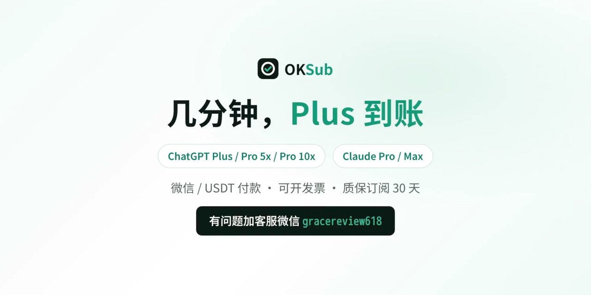](https://oksub.net/)

**🌐 Language / 语言:** **简体中文** | [English](./README.en.md) | [Русский](./README.ru.md)

# 🚀 ChatGPT 代充 / ChatGPT 充值 / ChatGPT 订阅保姆级教程（2026 最新）｜ChatGPT Plus / Pro / Codex 代充，几分钟到账，附 Claude 代充

**2026 年国内如何充值 / 订阅 ChatGPT Plus 会员？GPT Plus 代充、OpenAI 订阅视频图文教程（新手可用）**

> 面向国内 / 中文用户的 **ChatGPT Plus 充值教程**：无需国际信用卡，在一体化充值网站 **[OKSub（oksub.net）](https://oksub.net/)** 上 **微信 / USDT 付款**，付款后在订单页**自助充值到你自己的 ChatGPT 账号**，全程不需要账号密码。本文整理了从选套餐、付款、复制账号信息到确认 Plus 状态的完整 **图文 + 视频** 流程，新手可对照操作。
>
> 📅 最后更新：2026 年 11 月

## 📌 一句话回答：国内怎么充值 ChatGPT Plus？

不需要国际信用卡。打开 **[oksub.net](https://oksub.net/)** 选择 ChatGPT Plus 套餐，填写邮箱后用**微信或 USDT 付款**；付款成功会自动跳到订单页，在已登录 ChatGPT 的浏览器打开 `chatgpt.com/api/auth/session`，全选复制页面全部内容，粘贴回订单页后**直接提交充值**。通常几分钟即可完成，刷新 ChatGPT，账号就会从 **Free 升级为 Plus**。整个过程是给你自己的账号升级订阅（不是共享号、不是合租），聊天记录全部保留，订阅质保 30 天。

## 🎬 视频教程（约 2 分钟全流程演示，带语音讲解）

约 2 分钟看完完整流程，跟着视频操作即可；需要逐步核对时，可以展开下面折叠的图文步骤。

https://github.com/user-attachments/assets/2383ffa2-da6d-4785-b267-9425b47caffb

## 📋 关键信息一览

| 项目 | 说明 |
| --- | --- |
| 适用人群 | 已有自己的 ChatGPT 账号、没有国际信用卡的国内 / 中文用户 |
| 价格 | ChatGPT Plus **¥135 / 月**（30 天，对应官方 $20/月）；另有 Pro 100 ¥699、Pro 200 ¥1200 |
| 付款方式 | **微信支付**（推荐，扫码即付）、**USDT-BEP20**、**USDT-Polygon** |
| 充值方式 | 付款后在订单页粘贴 session 账号信息，直接提交自助充值，通常几分钟到账 |
| 账号前提 | Plus 需要账号当前为 **Free**（没有生效中的订阅）；Pro 100 支持覆盖充值 |
| 是否需要提供密码 | 不需要，只需在订单页粘贴 session 页面内容；**升级的是你自己的账号，聊天记录全部保留** |
| 质保 | 30 天订阅质保，中途掉订阅可联系客服处理 |
| 发票 | 可开电子普通发票（下单时选「需要发票」，每单加收 ¥10） |
| 能否使用 Codex | 可以 |
| 其他服务 | [Claude Pro / Max 成品号（免 KYC）](https://github.com/sunreview/Claude-Pro-Subscription-Guide) |
| 客服 | 微信 `gracereview716` / Telegram `@aispace_kefu` |

---

## 1. 🧰 充值 ChatGPT Plus 需要准备什么？

整个充值流程可以概括为：

**选套餐 → 填邮箱 → 微信 / USDT 付款 → 复制 session 账号信息 → 粘贴后直接提交 → 刷新 ChatGPT 查看 Plus**

开始之前，建议准备好下面几样东西。

### ① 一个可以正常登录的 ChatGPT 账号

先在浏览器打开 ChatGPT，确认：

- 可以正常登录；

- 邮箱是你准备升级的那个账号；

- 当前套餐是 **Free**（Plus 只能充值到没有生效中订阅的账号）；

- 账号是个人版：如果加入过 Team 空间，请先切回个人账号。

### ② 一个常用邮箱

下单时需要填写邮箱，付款成功后订单页链接会发到这个邮箱，方便随时回来继续充值或查单。

### ③ 微信或 USDT

推荐微信扫码付款；也支持 USDT-BEP20（BSC 链）和 USDT-Polygon（手续费低）。

---

## 2. 🖼️ ChatGPT Plus 充值图文步骤

上方视频已经演示了完整流程，图文步骤默认折叠，需要逐步核对时点开查看。

<b>📖 点击展开 6 步图文教程</b>

### 第 1 步：打开 OKSub，选择 ChatGPT Plus

打开 **[oksub.net](https://oksub.net/)**，往下找到「ChatGPT 套餐」，在 **ChatGPT Plus**（¥135 / 月 · 30 天）卡片上点「**立即充值**」。

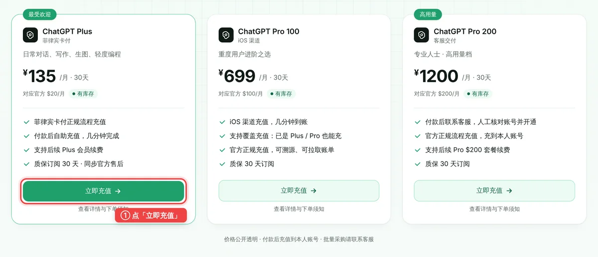

也可以直接打开下单页：[oksub.net/checkout/chatgpt-plus](https://oksub.net/checkout/chatgpt-plus)

### 第 2 步：填邮箱，选付款方式

进入「**第一步：填写信息**」页面：

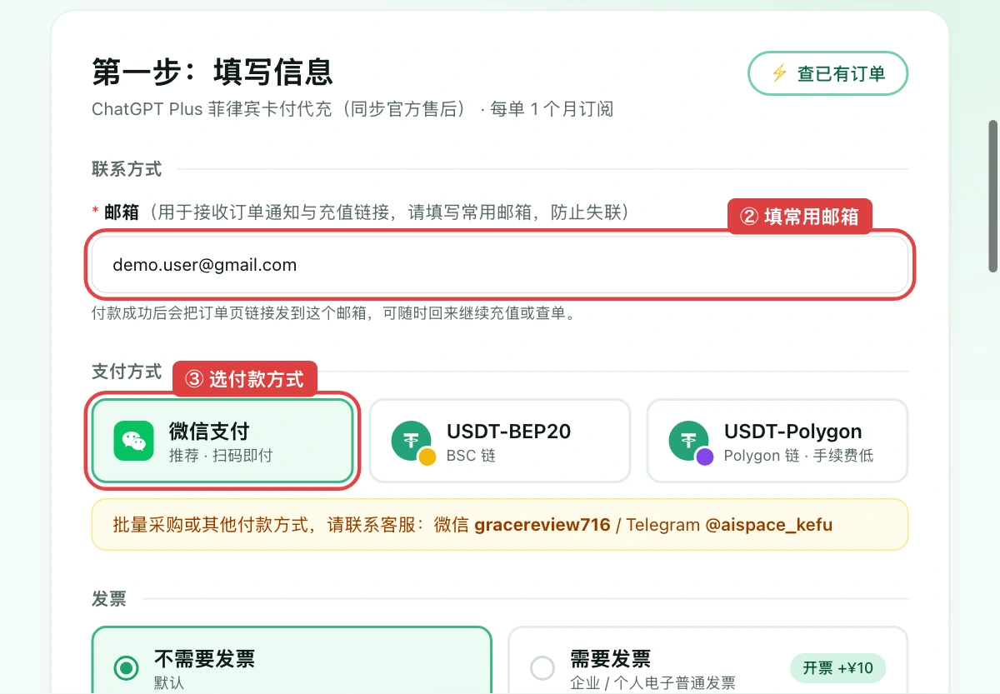

- **邮箱**：填你常用的邮箱。付款成功后订单页链接会发到这里，可以随时回来继续充值或查单。
- **支付方式**：微信支付（推荐，扫码即付）、USDT-BEP20（BSC 链）、USDT-Polygon（手续费低）三选一。

> 💡 批量采购或想用其他付款方式，可以联系客服：微信 **gracereview716** / Telegram **@aispace_kefu**。

### 第 3 步：确认须知，点「立即支付」

往下滑，**发票**默认是「不需要发票」，要开票就选「需要发票」。然后认真看一眼黄色的「**下单前请确认**」：

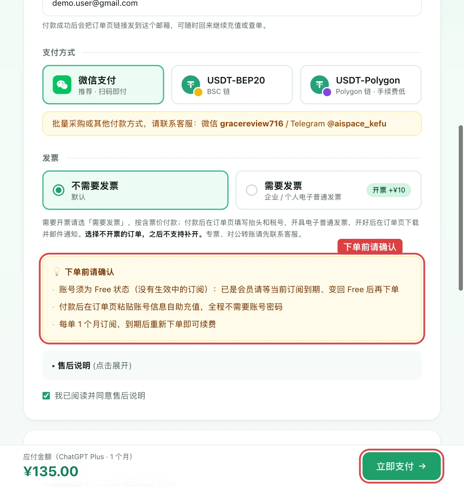

- 账号须为 **Free** 状态（没有生效中的订阅）；
- 付款后在订单页粘贴账号信息自助充值，**全程不需要账号密码**；
- 每单是 **1 个月**订阅，到期后重新下单即可续费。

确认没问题，并且「我已阅读并同意售后说明」是勾选状态（默认已勾选），点右下角的「**立即支付**」。

### 第 4 步：确认订单，扫码付款

进入「**确认付款**」页面，核对套餐、金额和联系邮箱，然后点「**前往安全支付**」：

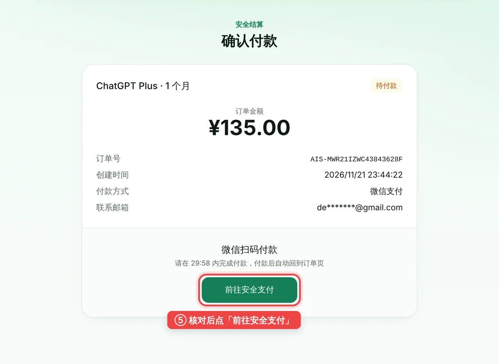

页面会出现微信付款二维码，**用微信扫一扫付款**就行。用手机下单的，可以截图保存二维码，在微信「扫一扫」右上角选相册识别：

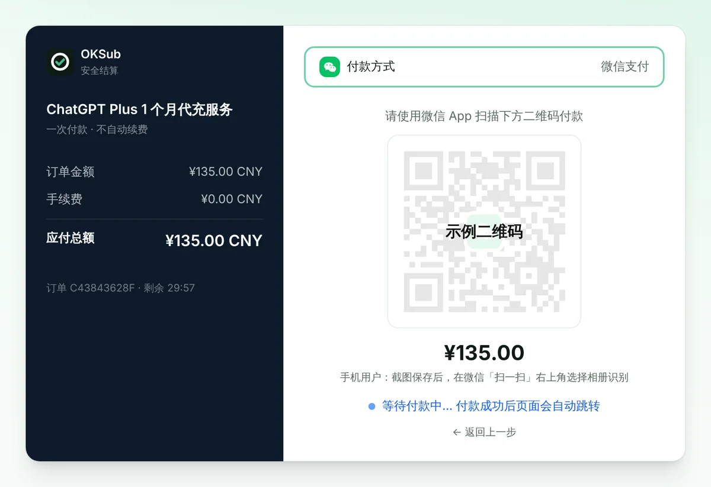

- ⏰ 请在 **30 分钟内**完成付款，超时订单会失效，需要重新下单。
- 🙅 付款后**不需要截图**发给谁，页面会自动检测到账。
- 选 USDT 的，页面会显示收款地址和**精确到小数的转账金额**，一定要用对应的网络、按页面金额一分不差地转。

### 第 5 步：付款成功，进入订单页

付款到账后页面显示「**付款成功！**」，3 秒后自动跳到订单页，也可以直接点「**前往充值**」：

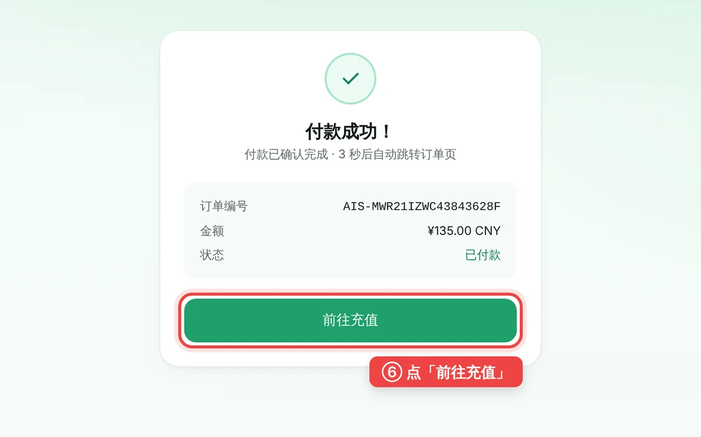

订单页上能看到订单状态「**已付款**」，下一步「开始充值」。建议先点订单号旁边的「**复制**」把订单号存好，查单、找客服都用得到 📝

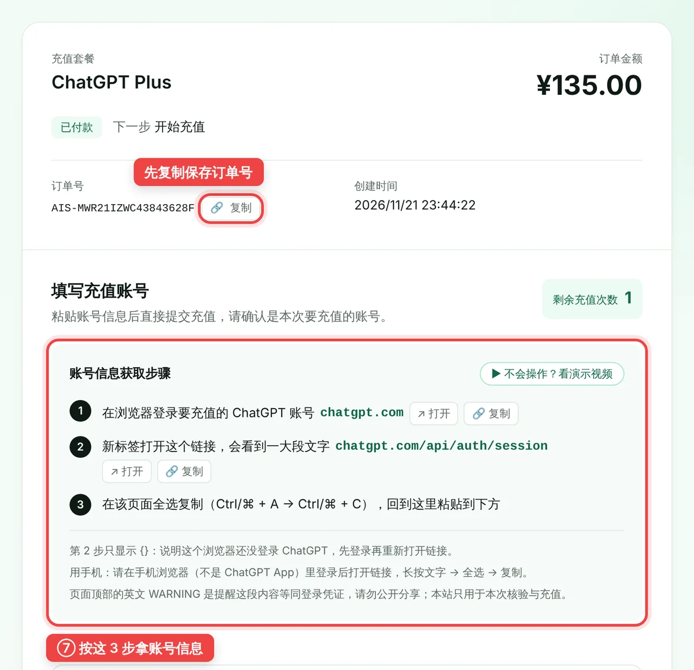

> 📬 不小心关掉了也没关系：订单页链接已经发到你的下单邮箱，也可以在 [订单查询](https://oksub.net/orders) 输入订单号或邮箱找回来。

### 第 6 步：复制账号信息，粘贴提交充值

这是最关键的一步，按订单页上「**账号信息获取步骤**」来：

**① 在浏览器登录要充值的 ChatGPT 账号**

打开 [chatgpt.com](https://chatgpt.com)，确认登录的就是你要升级 Plus 的那个账号。浏览器里登录了好几个账号的，一定要先确认当前是哪个。

**② 在同一个浏览器新开一个标签页，打开这个链接**

👉 **chatgpt.com/api/auth/session**

订单页上有「打开」和「复制」按钮，点一下就行。打开后会看到**一大段英文和符号**，这就是你的账号信息：

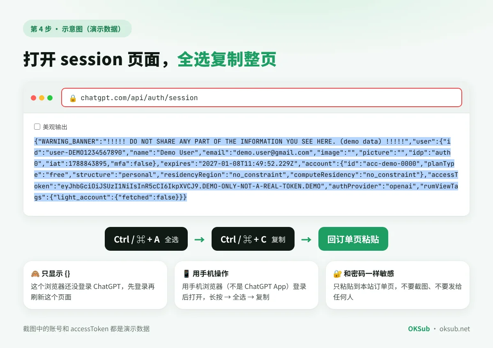

**③ 全选复制整页，回到订单页粘贴**

- **Windows**：按 `Ctrl + A` 全选，再按 `Ctrl + C` 复制；
- **Mac**：按 `⌘ + A` 全选，再按 `⌘ + C` 复制；
- **手机**：用手机浏览器（**不是 ChatGPT App**）登录后打开链接，长按文字 → 全选 → 复制。

回到订单页，粘贴到「**粘贴完整账号信息 JSON**」输入框（`Ctrl/⌘ + V`），然后点「**提交充值**」：

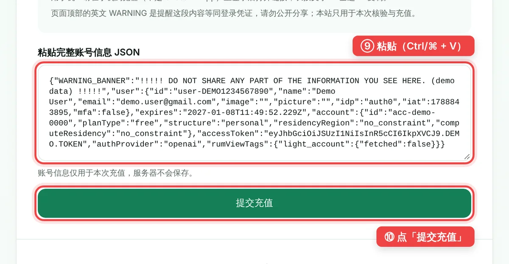

注意这几点 👇

- ✂️ **一定要复制整页**，不要只复制其中一段。ChatGPT Plus 粘贴后是**直接提交**的，没有预检这一步，复制不全会导致充值失败。
- 🙈 **页面只显示 `{}`**：说明这个浏览器还没登录 ChatGPT，先登录，再刷新 session 页面。
- 🌐 **先关掉浏览器的翻译插件**，翻译过的内容会被改乱。
- 🔐 **这段内容和密码一样敏感**（里面有登录凭证 accessToken），页面顶部的英文 WARNING 就是在提醒这个。**只粘贴到本站订单页**，不要截图、不要发给任何人，包括自称客服的人。本站只用它完成这次充值，服务器不会保存。

### ✅ 等待充值完成，回 ChatGPT 确认

提交后系统会自动处理，进度依次是 **提交充值 → 充值处理 → 充值完成**，一般几分钟。等待期间**不要退出 ChatGPT、不要切换账号，也不要重复提交**。可以关掉页面，完成后会发邮件通知。

看到「**100% · 充值服务已确认完成**」就说明充值成功了 🎉

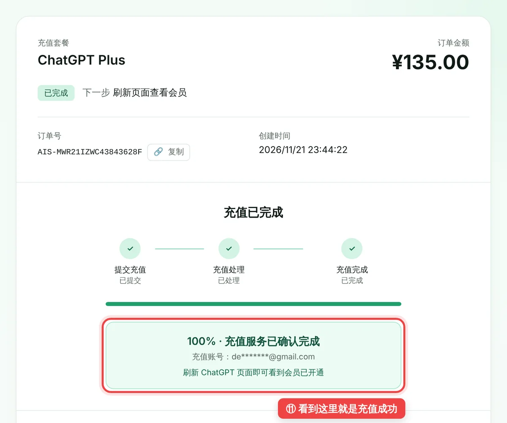

最后回到 ChatGPT **刷新页面**：左下角名字下面从「Free / 免费版」变成「**Plus**」，或者在 设置 → **Billing**（账单）里看到 **ChatGPT Plus**，就是升级成功了 💎

如果刷新后还是 Free，按顺序试试：等几十秒 → 再刷新 → 退出 ChatGPT 重新登录 → 去 Billing 里看。还不行就带着订单号找客服。

---

## 3. ❓ ChatGPT Plus 充值常见问题 FAQ

### Q1：ChatGPT 在国内怎么充值？支持哪些付款方式？

支持 **微信支付** 和 **USDT（BEP20 / Polygon）** 付款，无需海外信用卡、PayPal 或虚拟卡。付款后自动进入订单页，粘贴账号信息即可自助充值，通常几分钟完成。

### Q2：ChatGPT Plus 怎么开通？

国内开通 ChatGPT Plus 不需要国际信用卡：在 [oksub.net](https://oksub.net/) 选择 ChatGPT Plus 套餐，用微信或 USDT 付款，然后在订单页粘贴 session 账号信息直接提交充值，通常几分钟即可开通。详细操作见上方视频，或展开「ChatGPT Plus 充值图文步骤」。

### Q3：ChatGPT Plus 多少钱一个月？Plus 和 Pro 怎么选？

| 套餐 | 价格（30 天） | 对应官方 | 适合 |
| --- | --- | --- | --- |
| ChatGPT Plus | ¥135 | $20/月 | 日常对话、写作、生图、轻度编程 |
| ChatGPT Pro 100 | ¥699 | $100/月 | 重度用户，Codex 等用量更大 |
| ChatGPT Pro 200 | ¥1200 | $200/月 | 专业用户，最高用量档 |

大多数人选 Plus 就够用；经常撞到用量上限、重度使用 Codex 再考虑 Pro。Pro 200 付款后由客服人工核对账号并开通。

### Q4：充值需要把 ChatGPT 密码给别人吗？

不需要。全程不要账号密码，只需在订单页粘贴 session 页面的内容（含登录凭证 Access Token）完成自助充值。这段内容和密码一样敏感，**只粘贴到本站订单页**，不要截图或发给任何人，包括自称客服的人。

### Q5：充值前账号需要满足什么条件？

ChatGPT Plus 需要账号当前为 **Free** 状态（没有生效中的订阅），不可覆盖已有订阅；Pro 100 支持覆盖充值，已有 Plus / Pro 也可以充。账号须为个人版，如加入过 Team 空间，请先切回个人账号再复制 session。

### Q6：粘贴后提示「复制不完整」或「无法识别账号」怎么办？

按顺序检查：

1. 打开 session 页面后用 `Ctrl + A`（Mac 用 `⌘ + A`）全选，再 `Ctrl + C` 复制完整内容，不要只复制一部分；

2. 不要开启浏览器翻译；

3. 确认浏览器里登录的就是要充值的那个 ChatGPT 账号；

4. 如果刚才登录过期，刷新 ChatGPT 后重新打开 session 页面再复制。

仍然不行请联系客服并附上订单号。

### Q7：显示充值完成，但 ChatGPT 还是 Free 怎么办？

可以依次尝试：

1. 刷新 ChatGPT 页面；
2. 等待几十秒后再看；
3. 退出账号重新登录；
4. 打开设置里的 Billing / 套餐页面确认；
5. 仍未生效，请保存订单号联系客服处理。

### Q8：充值失败怎么办？

不要反复重复提交。充值未成功时订单页会显示原因，额度已退回的可以按提示修正后重新提交。

如需客服协助，请提供：

- 订单号；

- 错误提示截图；

- 充值账号邮箱。

**不要提供密码或 session 内容。**

### Q9：ChatGPT Plus 可以使用 Codex 吗？

可以，Plus 和 Pro 都自带 Codex。建议先在默认浏览器登录好 ChatGPT 账号，再用同一个默认浏览器登录 Codex，这样通常不用再接短信验证码。

### Q10：会充到我自己的账号吗？安全吗？

会。所有套餐都通过官方正规流程充值到你本人账号，不是共享号、不是合租，聊天记录和设置全部保留。粘贴的账号信息仅用于本次核验与充值，请勿公开分享给他人。

### Q11：质保怎么算？

质保订阅 30 天。质保期内如果 Plus / Pro 订阅中途掉了，请及时联系客服（微信 `gracereview716` / Telegram `@aispace_kefu`）并附上订单号处理。如因使用不当导致封号，按 OpenAI 官方售后规则处理。

### Q12：可以开发票吗？

可以。下单时选择「需要发票」（每单加收 ¥10 开票费），付款后在订单页填写抬头和税号（企业或个人均可），开具电子普通发票，开好后在订单页下载并邮件通知，一般 1–3 个工作日。选择不开票的订单之后不支持补开；专票、对公转账请先联系客服。

### Q13：可以一次买多个月吗？

每单为 1 个月订阅。会员到期后重新下单即可续费；需要批量采购请联系客服。

### Q14：下单后在哪里查订单？

付款成功后订单页链接会发到你的下单邮箱；也可以在 [订单查询](https://oksub.net/orders) 页面输入订单号或下单邮箱查询。

### Q15：可以买 Claude 吗？

可以。Claude 代充目前暂停，现在提供 **免 KYC 的 Claude Pro / Max 成品号**（交付现成账号，不是给你的账号充值），详细说明见：[Claude Pro / Max 成品号指南](https://github.com/sunreview/Claude-Pro-Subscription-Guide)。

---

## 4. 💬 联系客服

如果你按照上面的步骤操作后，仍然遇到付款、提交充值、充值结果等问题，可以联系客服协助处理，联系时请附上**订单号**。

### 📱 微信客服

**微信号：`gracereview716`**

### ✈️ Telegram 客服

**[@aispace_kefu](https://t.me/aispace_kefu)**

添加时可以备注：

> ChatGPT Plus 充值 + 订单号

---

## 🎯 最后总结

第一次操作时，不要追求快，尤其要确认 **登录的是要充值的那个账号、账号当前是 Free，并且复制了 session 页面的全部内容**：粘贴后是直接提交的，没有预检这一步。

### 🚀 相关入口

- [OKSub 一体化充值网站](https://oksub.net/)
- [Claude Pro / Max 成品号指南](https://github.com/sunreview/Claude-Pro-Subscription-Guide)

如果这篇教程对你有帮助，可以 **Star ⭐ / 收藏**，以后续费时直接回来查看。
