[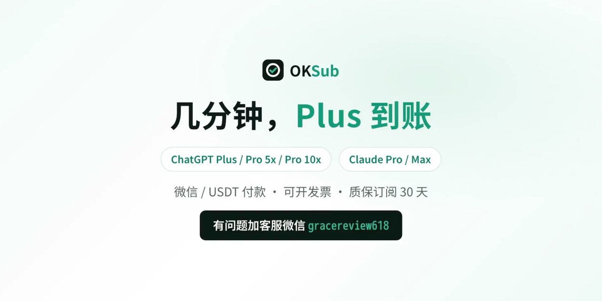](https://oksub.net/)

**🌐 Language / 语言:** [简体中文](./README.md) | [English](./README.en.md) | **Русский**

# 🚀 Оплата и подписка ChatGPT Plus / Pro без зарубежной карты (2026) — активация за несколько минут, также пополнение Claude

**Как оплатить / оформить подписку ChatGPT Plus в 2026 году — пошаговое видео- и фото-руководство для новичков**

> **Руководство по пополнению ChatGPT Plus** для тех, у кого нет международной банковской карты: на универсальном сайте пополнения **[OKSub (oksub.net)](https://oksub.net/)** вы **оплачиваете через WeChat Pay или USDT**, а затем **сами пополняете свой аккаунт ChatGPT** на странице заказа — пароль от аккаунта не нужен. В статье собран полный процесс **с картинками и видео**: выбор тарифа, оплата, копирование данных аккаунта и проверка статуса Plus.
>
> 📅 Последнее обновление: ноябрь 2026

## 📌 Ответ в одном предложении: как оплатить ChatGPT Plus без международной карты?

Международная карта не нужна. Откройте **[oksub.net](https://oksub.net/)**, выберите тариф ChatGPT Plus, укажите e-mail и **оплатите через WeChat Pay или USDT**. После оплаты вы автоматически попадёте на страницу заказа. В браузере, где вы вошли в ChatGPT, откройте `chatgpt.com/api/auth/session`, выделите и скопируйте всё содержимое страницы, вставьте его обратно на странице заказа и **сразу отправьте на пополнение**. Обычно через несколько минут обновите ChatGPT — аккаунт перейдёт с **Free на Plus**. Подписка оформляется на ваш собственный аккаунт (не общий и не складчина), история чатов полностью сохраняется, гарантия на подписку — 30 дней.

## 🎬 Видеоурок (полный процесс, ~2 минуты, озвучка на китайском)

Сначала посмотрите весь процесс (около 2 минут), чтобы понять общую картину, а затем следуйте пошаговым инструкциям с картинками ниже.

[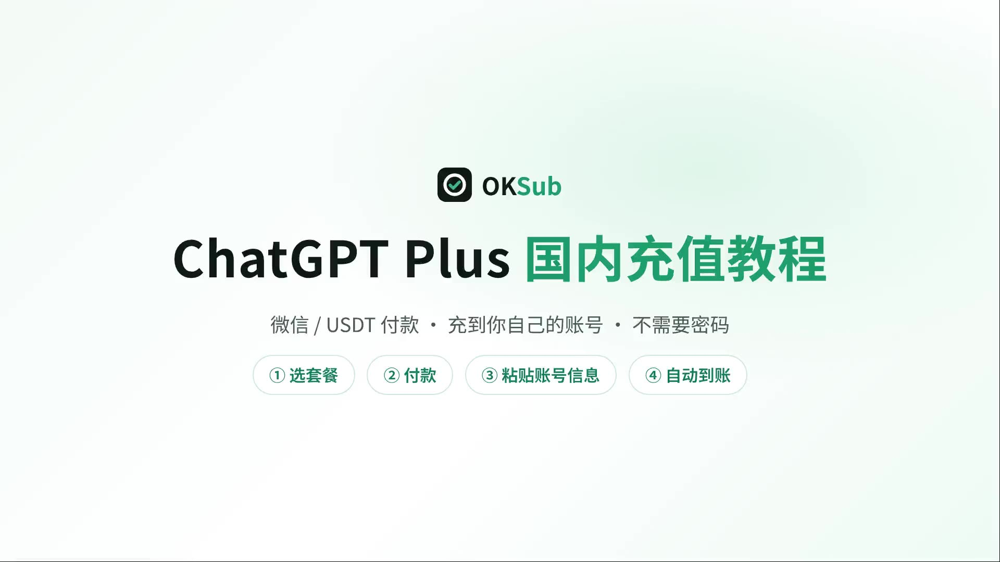](./plus-tutorial-v2.mp4)

> ▶️ Нажмите на обложку выше, чтобы воспроизвести видео. Его также можно посмотреть на [главной странице OKSub](https://oksub.net/) или [скачать видеофайл](./plus-tutorial-v2.mp4). Почта и аккаунт в видео — демонстрационные данные.

## 📋 Ключевая информация кратко

| Пункт | Описание |
| --- | --- |
| Для кого | Для тех, у кого уже есть свой аккаунт ChatGPT, но нет международной карты |
| Цена | ChatGPT Plus **¥135 / месяц** (30 дней, соответствует официальным $20/мес.); также доступны Pro 100 ¥699 и Pro 200 ¥1200 |
| Способы оплаты | **WeChat Pay** (рекомендуется, оплата по QR-коду), **USDT-BEP20**, **USDT-Polygon** |
| Как это работает | После оплаты вставьте данные session на странице заказа и сразу отправьте на пополнение — обычно за несколько минут |
| Требования к аккаунту | Для Plus аккаунт должен быть сейчас на **Free** (без активной подписки); Pro 100 можно оформить поверх текущего тарифа |
| Нужен ли пароль | Нет, нужно лишь вставить содержимое страницы session на странице заказа; **повышается ваш собственный аккаунт, поэтому история чатов полностью сохраняется** |
| Гарантия | 30 дней на подписку; если Plus слетит, обратитесь в поддержку |
| Счёт / фапяо | Можно получить электронный счёт (при заказе выберите «需要发票», +¥10 за заказ) |
| Можно ли пользоваться Codex | Да |
| Другие услуги | [Готовые аккаунты Claude Pro / Max (без KYC)](https://github.com/sunreview/Claude-Pro-Subscription-Guide) |
| Поддержка | WeChat `gracereview716` / Telegram `@aispace_kefu` |

---

## 1. 🧰 Что нужно для пополнения ChatGPT Plus?

Весь процесс пополнения можно описать так:

**Выбрать тариф → Указать e-mail → Оплатить WeChat / USDT → Скопировать данные session → Вставить и сразу отправить → Обновить ChatGPT и увидеть Plus**

Перед началом рекомендуется подготовить следующее.

### ① Аккаунт ChatGPT, в который вы можете войти

Сначала откройте ChatGPT в браузере и убедитесь, что:

- Вход выполняется нормально;

- Почта — это тот аккаунт, который вы хотите повысить;

- Текущий тариф — **Free** (Plus можно оформить только на аккаунт без активной подписки);

- Это личный аккаунт: если вы вступали в рабочее пространство Team, сначала переключитесь на личный аккаунт.

### ② E-mail, которым вы регулярно пользуетесь

При заказе нужно указать e-mail. После оплаты ссылка на страницу заказа придёт на эту почту, чтобы вы могли в любой момент вернуться и продолжить пополнение или проверить заказ.

### ③ WeChat Pay или USDT

Рекомендуется оплата WeChat по QR-коду; также поддерживаются USDT-BEP20 (сеть BSC) и USDT-Polygon (низкая комиссия).

---

## 2. 🖼️ Пошаговые действия с картинками

Переходим к самому пополнению. Посмотрев видео выше, выполняйте шаги с картинками ниже по порядку.

### Шаг 1: Откройте OKSub и выберите ChatGPT Plus 🚪

Откройте **[oksub.net](https://oksub.net/)**, прокрутите до раздела «ChatGPT 套餐» (Тарифы ChatGPT) и на карточке **ChatGPT Plus** (¥135 / месяц · 30 дней) нажмите **«立即充值»** (Пополнить).

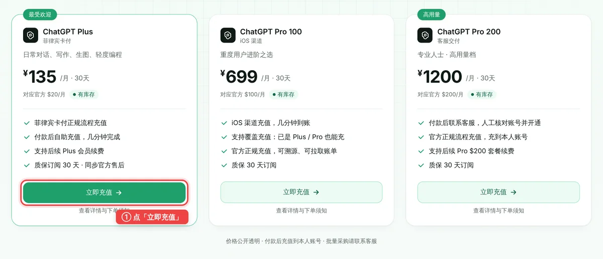

Можно сразу открыть страницу оформления: [oksub.net/checkout/chatgpt-plus](https://oksub.net/checkout/chatgpt-plus)

### Шаг 2: Укажите e-mail и выберите способ оплаты ✉️

Откроется страница **«第一步：填写信息»** (Шаг 1: заполните данные):

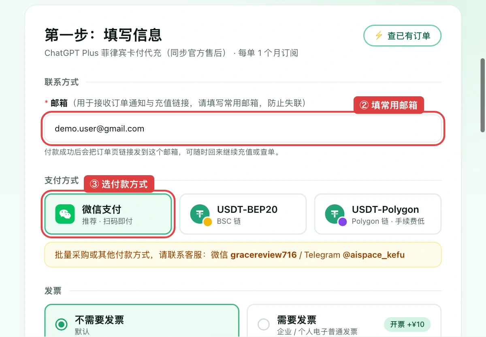

- **E-mail**: укажите почту, которую регулярно проверяете. После оплаты сюда придёт ссылка на страницу заказа, чтобы вы могли в любой момент вернуться и продолжить пополнение или проверить заказ.
- **Способ оплаты**: на выбор WeChat Pay (рекомендуется, оплата по QR-коду), USDT-BEP20 (сеть BSC) или USDT-Polygon (низкая комиссия).

> 💡 Для оптовых покупок или других способов оплаты свяжитесь с поддержкой: WeChat **gracereview716** / Telegram **@aispace_kefu**.

### Шаг 3: Прочитайте условия и нажмите «立即支付» (Оплатить) 💳

Прокрутите вниз. В разделе **«发票»** (Счёт) по умолчанию выбрано «不需要发票» (Счёт не нужен); если нужен счёт, выберите «需要发票» (Нужен счёт). Затем внимательно прочитайте жёлтый блок **«下单前请确认»** (Проверьте перед заказом):

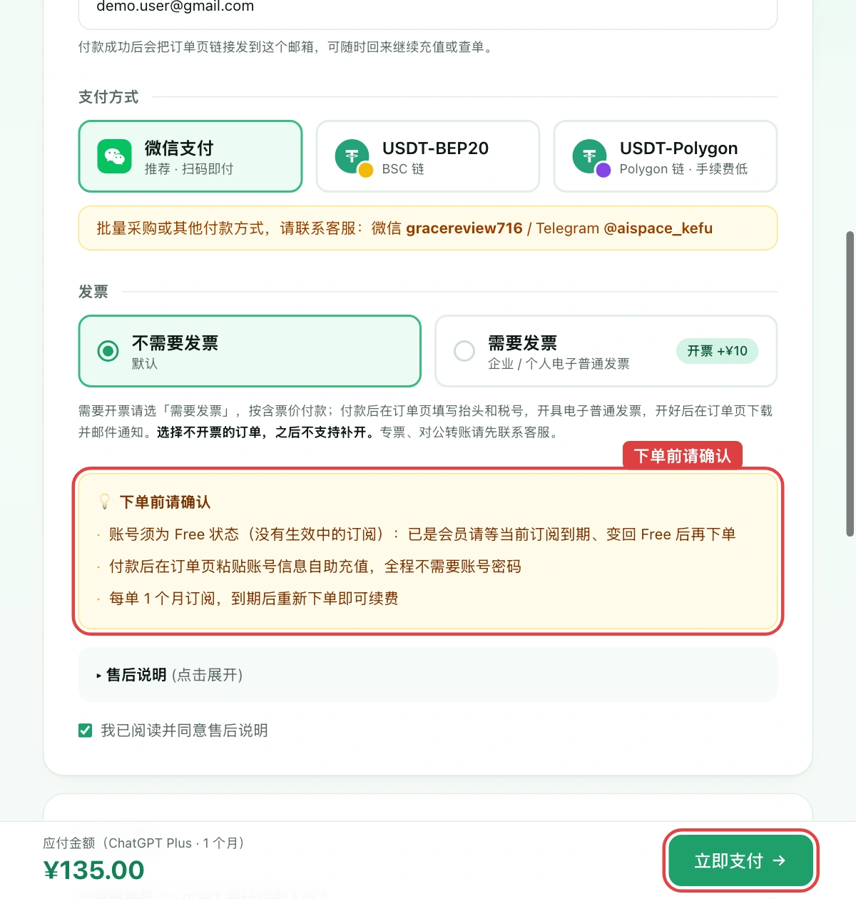

- Аккаунт должен быть на тарифе **Free** (без действующей подписки);
- После оплаты вы сами вставляете данные аккаунта на странице заказа — **пароль от аккаунта не нужен ни на одном шаге**;
- Каждый заказ — подписка на **1 месяц**; для продления после окончания оформите новый заказ.

Если всё верно и отмечено «我已阅读并同意售后说明» (Я прочитал(а) и согласен(на) с условиями обслуживания) — по умолчанию отмечено, — нажмите **«立即支付»** (Оплатить) справа внизу.

### Шаг 4: Подтвердите заказ и оплатите по QR-коду 📱

На странице **«确认付款»** (Подтверждение оплаты) проверьте тариф, сумму и контактную почту, затем нажмите **«前往安全支付»** (Перейти к безопасной оплате):

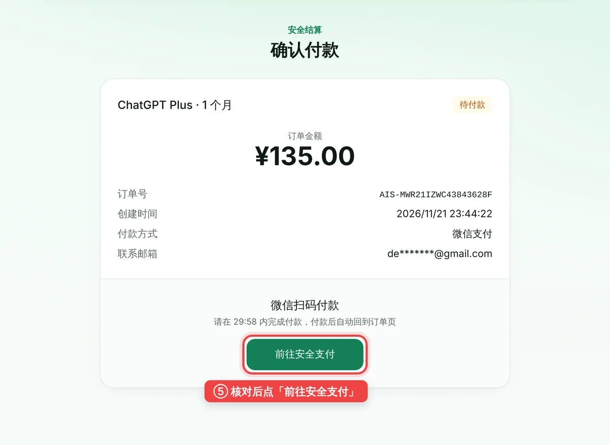

Появится QR-код для оплаты в WeChat — просто **отсканируйте его в WeChat и оплатите**. Если вы оформляете заказ с телефона, сохраните скриншот QR-кода и в «Сканировать» WeChat нажмите значок альбома в правом верхнем углу, чтобы распознать его:

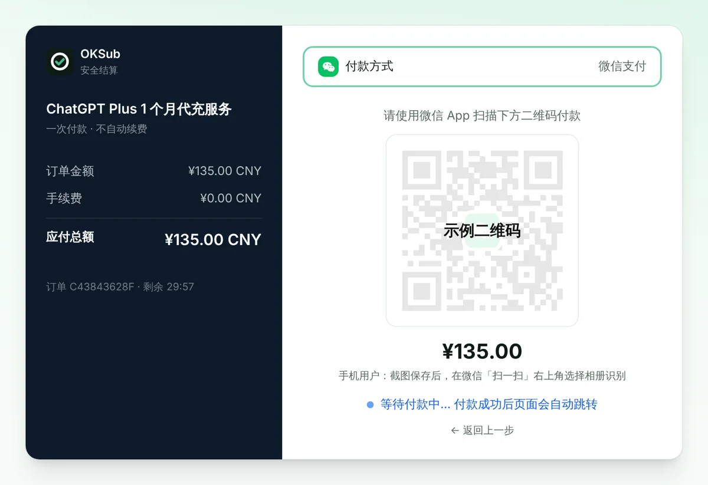

- ⏰ Оплатите **в течение 30 минут** — просроченный заказ станет недействительным, и его придётся оформить заново.
- 🙅 После оплаты **не нужно никому отправлять скриншот** — страница сама определит поступление платежа.
- Если выбрали USDT, на странице будут адрес получателя и **точная сумма перевода до знака после запятой**. Используйте нужную сеть и переведите ровно указанную сумму.

### Шаг 5: Оплата прошла — переходите на страницу заказа 🎉

Когда платёж поступит, страница покажет **«付款成功！»** (Оплата прошла успешно!) и через 3 секунды перейдёт на страницу заказа; можно также нажать **«前往充值»** (Перейти к пополнению):

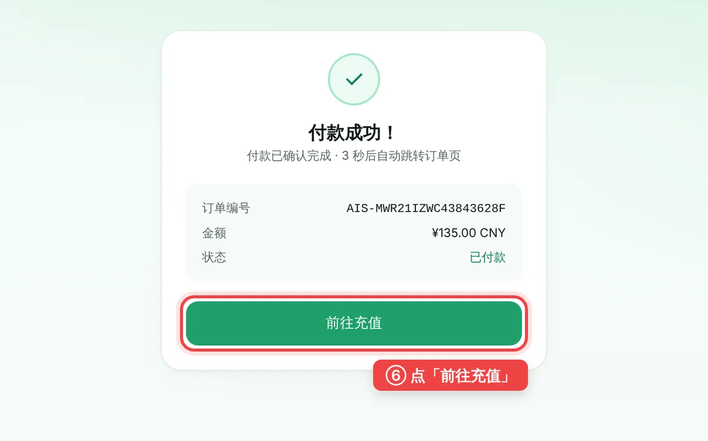

На странице заказа будет статус **«已付款»** (Оплачено) и следующий шаг «开始充值» (Начать пополнение). Советуем сначала нажать **«复制»** (Копировать) рядом с номером заказа и сохранить его — он понадобится для поиска заказа и обращения в поддержку 📝

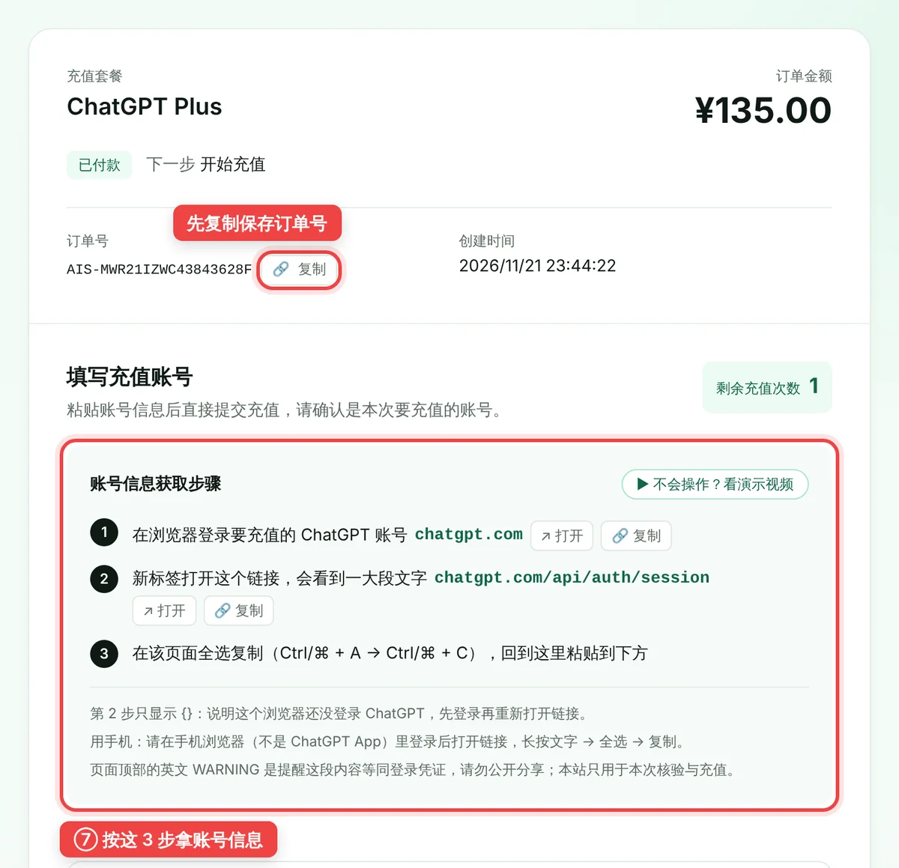

> 📬 Случайно закрыли страницу? Ничего страшного: ссылка на страницу заказа уже отправлена на вашу почту, а ещё заказ можно найти в разделе [Поиск заказа](https://oksub.net/orders) по номеру заказа или e-mail.

### Шаг 6: Скопируйте данные аккаунта, вставьте и отправьте на пополнение 🔗

Это самый важный шаг. Следуйте блоку **«账号信息获取步骤»** (Как получить данные аккаунта) на странице заказа:

**① Войдите в браузере в аккаунт ChatGPT, который хотите пополнить**

Откройте [chatgpt.com](https://chatgpt.com) и убедитесь, что вошли именно в тот аккаунт, который нужно перевести на Plus. Если в браузере открыто несколько аккаунтов, сначала проверьте, какой из них активен.

**② В том же браузере откройте новую вкладку и перейдите по ссылке**

👉 **chatgpt.com/api/auth/session**

На странице заказа для неё есть кнопки «打开» (Открыть) и «复制» (Копировать). Вы увидите **длинный блок английского текста и символов** — это и есть данные вашего аккаунта:

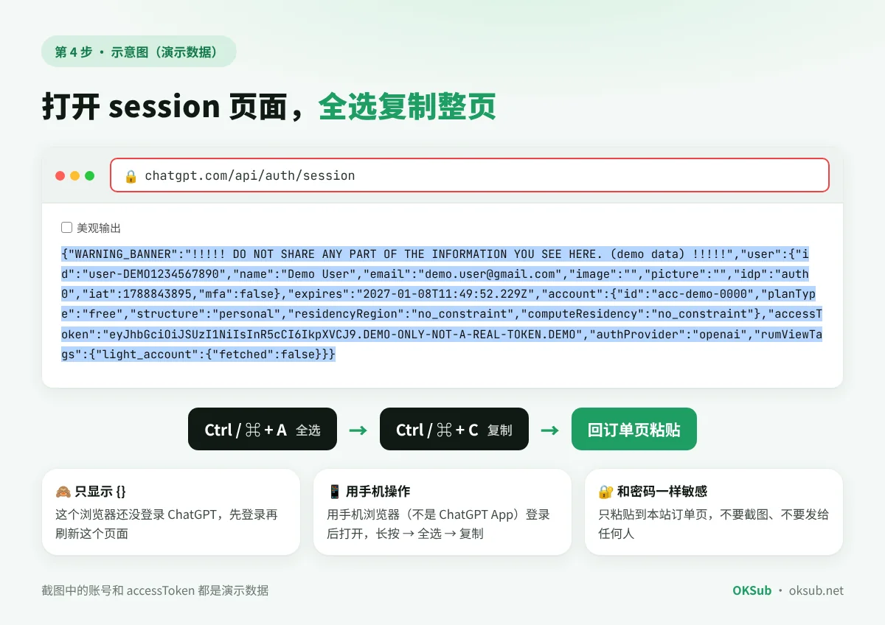

**③ Выделите и скопируйте всю страницу, затем вставьте на странице заказа**

- **Windows**: нажмите `Ctrl + A`, чтобы выделить всё, затем `Ctrl + C`, чтобы скопировать;
- **Mac**: нажмите `⌘ + A`, затем `⌘ + C`;
- **Телефон**: войдите через мобильный браузер (**не через приложение ChatGPT**), откройте ссылку, долгое нажатие на текст → Выбрать всё → Копировать.

Вернитесь на страницу заказа, вставьте содержимое в поле **«粘贴完整账号信息 JSON»** (Вставьте полный JSON с данными аккаунта) (`Ctrl/⌘ + V`) и нажмите **«提交充值»** (Отправить на пополнение):

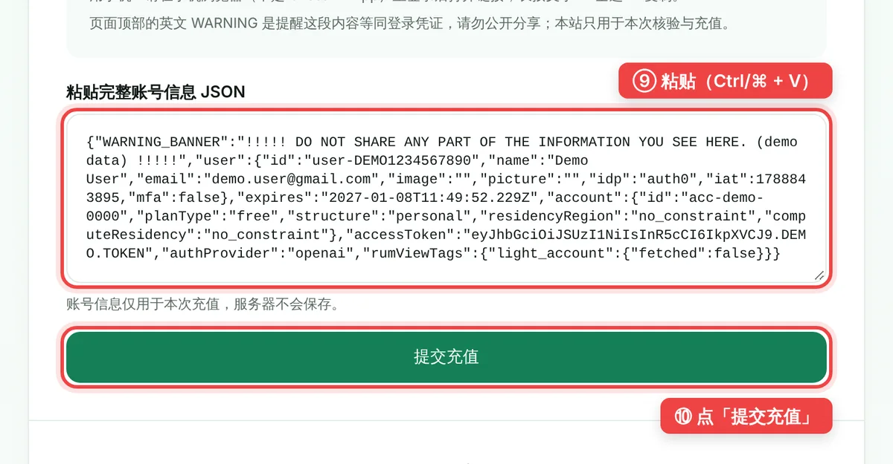

Обратите внимание 👇

- ✂️ **Обязательно копируйте всю страницу**, а не её часть. Для ChatGPT Plus содержимое после вставки **отправляется сразу** — предпроверки нет, поэтому неполная копия приведёт к неудачному пополнению.
- 🙈 **На странице только `{}`**: этот браузер ещё не вошёл в ChatGPT. Сначала войдите, затем обновите страницу session.
- 🌐 **Сначала отключите расширения-переводчики** — переведённый текст будет испорчен.
- 🔐 **Эти данные так же секретны, как пароль** (в них есть токен входа accessToken) — именно об этом предупреждает английское WARNING вверху страницы. **Вставляйте их только на странице заказа на этом сайте.** Не делайте скриншотов и никому не отправляйте, в том числе тем, кто называет себя поддержкой. Мы используем их только для этого пополнения, сервер их не сохраняет.

### ✅ Дождитесь завершения пополнения и проверьте ChatGPT 💎

После отправки система всё сделает автоматически. Этапы идут так: **提交充值 (Отправлено) → 充值处理 (Обработка) → 充值完成 (Завершено)**, обычно за несколько минут. Пока ждёте, **не выходите из ChatGPT, не переключайте аккаунт и не отправляйте повторно**. Страницу можно закрыть — по завершении придёт письмо.

Если видите **«100% · 充值服务已确认完成»** (100% · Пополнение подтверждено), всё прошло успешно 🎉

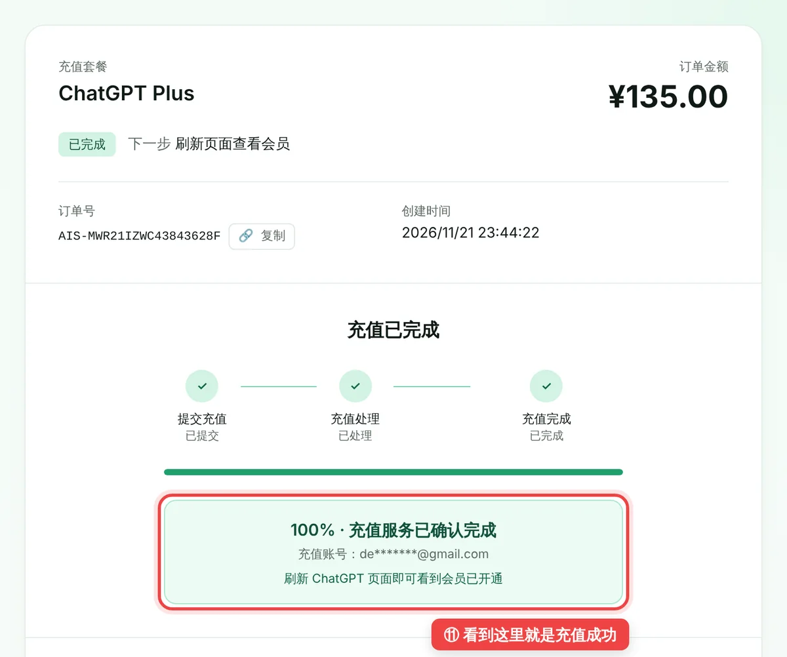

Наконец, вернитесь в ChatGPT и **обновите страницу**: если под вашим именем слева внизу вместо «Free» появилось **«Plus»** или в Настройки → **Billing** (Оплата) отображается **ChatGPT Plus**, подписка подключена 💎

Если после обновления всё ещё Free, попробуйте по порядку: подождать несколько десятков секунд → обновить ещё раз → выйти из ChatGPT и войти снова → проверить Billing. Если не помогло, обратитесь в поддержку с номером заказа.

---

## 3. ❓ Частые вопросы по пополнению ChatGPT Plus (FAQ)

### В1: Как оплатить ChatGPT без международной карты? Какие способы оплаты поддерживаются?

Поддерживаются **WeChat Pay** и **USDT (BEP20 / Polygon)** — зарубежная карта, PayPal или виртуальная карта не нужны. После оплаты вы сразу попадаете на страницу заказа, вставляете данные аккаунта и пополняете сами, обычно за несколько минут.

### В2: Как подключить ChatGPT Plus?

Международная карта не нужна: выберите тариф ChatGPT Plus на [oksub.net](https://oksub.net/), оплатите через WeChat Pay или USDT, затем вставьте данные session на странице заказа и сразу отправьте на пополнение — обычно Plus подключается за несколько минут. Подробности — в разделе «Пошаговые действия с картинками» выше.

### В3: Сколько стоит ChatGPT Plus в месяц? Что выбрать: Plus или Pro?

| Тариф | Цена (30 дней) | Официальный аналог | Для кого |
| --- | --- | --- | --- |
| ChatGPT Plus | ¥135 | $20/мес. | Повседневные чаты, тексты, генерация изображений, лёгкое программирование |
| ChatGPT Pro 100 | ¥699 | $100/мес. | Активные пользователи, больше лимитов на Codex и др. |
| ChatGPT Pro 200 | ¥1200 | $200/мес. | Профессионалы, максимальный уровень лимитов |

Большинству хватает Plus; Pro стоит рассмотреть, если вы часто упираетесь в лимиты или активно пользуетесь Codex. Для Pro 200 после оплаты поддержка вручную проверяет аккаунт и подключает подписку.

### В4: Нужно ли кому-то передавать пароль от ChatGPT?

Нет. Пароль не нужен ни на одном этапе — вы лишь вставляете на странице заказа содержимое страницы session (оно содержит учётные данные Access Token). Это содержимое так же конфиденциально, как пароль: **вставляйте его только на странице заказа этого сайта**, не делайте скриншоты и никому не отправляйте, в том числе тем, кто представляется поддержкой.

### В5: Каким условиям должен соответствовать аккаунт перед пополнением?

Для ChatGPT Plus аккаунт должен быть сейчас на **Free** (без активной подписки), поверх существующей подписки оформить нельзя; Pro 100 можно оформить поверх — подходят аккаунты уже с Plus / Pro. Аккаунт должен быть личным: если вы вступали в рабочее пространство Team, перед копированием session переключитесь на личный аккаунт.

### В6: После вставки пишет «скопировано не полностью» или «не удаётся распознать аккаунт». Что делать?

Проверьте по порядку:

1. На странице session нажмите `Ctrl + A` (на Mac `⌘ + A`), затем `Ctrl + C`, чтобы скопировать всё содержимое, а не его часть;

2. Не включайте перевод страницы в браузере;

3. Убедитесь, что в браузере выполнен вход именно в тот аккаунт ChatGPT, который нужно пополнить;

4. Если сессия только что истекла, обновите ChatGPT, снова откройте страницу session и скопируйте заново.

Если не помогло, обратитесь в поддержку и укажите номер заказа.

### В7: Пишет, что пополнение завершено, но ChatGPT всё ещё Free. Что делать?

Попробуйте по порядку:

1. Обновить страницу ChatGPT;
2. Подождать несколько десятков секунд и проверить снова;
3. Выйти из аккаунта и войти снова;
4. Открыть Billing / тариф в настройках и проверить;
5. Если всё ещё не активно, сохраните номер заказа и обратитесь в поддержку.

### В8: Что делать, если пополнение не удалось?

Не отправляйте запрос повторно снова и снова. Если пополнение не прошло, на странице заказа будет указана причина; если лимит возвращён, исправьте проблему по подсказке и отправьте снова.

Если нужна помощь поддержки, предоставьте:

- Номер заказа;

- Скриншот сообщения об ошибке;

- Почту пополняемого аккаунта.

**Не передавайте пароль или содержимое session.**

### В9: Можно ли с ChatGPT Plus пользоваться Codex?

Да, и в Plus, и в Pro есть Codex. Сначала войдите в ChatGPT в браузере по умолчанию, затем войдите в Codex через тот же браузер — так обычно не понадобится SMS-код.

### В10: Пополнится ли именно мой аккаунт? Это безопасно?

Да. Все тарифы оформляются на ваш собственный аккаунт через официальный легальный процесс — это не общий аккаунт и не складчина, история чатов и настройки полностью сохраняются. Вставленные данные аккаунта используются только для этого пополнения; не публикуйте их.

### В11: Как работает гарантия?

Гарантия на подписку — 30 дней. Если в течение гарантийного срока подписка Plus / Pro слетит, своевременно обратитесь в поддержку (WeChat `gracereview716` / Telegram `@aispace_kefu`) и укажите номер заказа. Блокировки из-за ненадлежащего использования рассматриваются по официальным правилам OpenAI.

### В12: Можно ли получить счёт (фапяо)?

Да. При заказе выберите «需要发票» (Нужен счёт, +¥10 за заказ); после оплаты укажите на странице заказа название и налоговый номер (компания или физлицо). Выставляется электронный обычный счёт, его можно скачать на странице заказа, также придёт уведомление на почту — обычно в течение 1–3 рабочих дней. Для заказов без счёта выставить его позже нельзя; по специальным счетам НДС и оплате с расчётного счёта компании сначала свяжитесь с поддержкой.

### В13: Можно ли купить сразу несколько месяцев?

Каждый заказ — подписка на 1 месяц. По истечении просто оформите новый заказ для продления; для оптовых покупок свяжитесь с поддержкой.

### В14: Где посмотреть заказ?

После оплаты ссылка на страницу заказа приходит на почту, указанную при заказе; также можно найти заказ на странице [Поиск заказа](https://oksub.net/orders) по номеру заказа или e-mail.

### В15: Можно ли получить Claude?

Да. Пополнение Claude сейчас приостановлено; вместо него доступны **готовые аккаунты Claude Pro / Max без KYC** (вы получаете новый аккаунт, а не пополнение своего). Подробнее: [Руководство по аккаунтам Claude Pro / Max](https://github.com/sunreview/Claude-Pro-Subscription-Guide).

---

## 4. 💬 Связь с поддержкой

Если после выполнения шагов выше у вас остались проблемы с оплатой, отправкой на пополнение или результатом пополнения, обратитесь в поддержку — пожалуйста, укажите **номер заказа**.

### 📱 Поддержка в WeChat

**WeChat ID: `gracereview716`**

### ✈️ Поддержка в Telegram

**[@aispace_kefu](https://t.me/aispace_kefu)**

При добавлении можно указать примечание:

> Пополнение ChatGPT Plus + номер заказа

---

## 🎯 Итог

В первый раз не торопитесь — особенно внимательно проверьте, что **вы вошли в нужный аккаунт, он на тарифе Free и вы скопировали всю страницу session**: после вставки данные отправляются сразу, предпроверки нет.

### 🚀 Полезные ссылки

- [Универсальный сайт пополнения OKSub](https://oksub.net/)
- [Руководство по аккаунтам Claude Pro / Max](https://github.com/sunreview/Claude-Pro-Subscription-Guide)

Если руководство было полезным, поставьте **Star ⭐ / добавьте в закладки**, чтобы вернуться к нему при следующем продлении.
